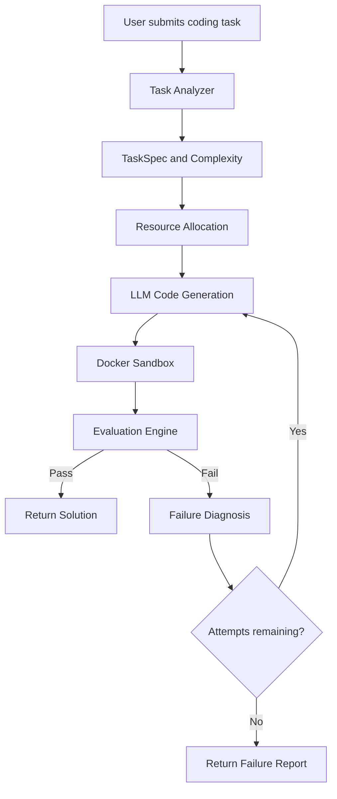

# Sandboxed Coding Agent — Master Implementation Roadmap

**Status:** Proposed execution baseline  
**Target:** Production-ready MVP  
**Priorities:** System design, LLM/agent evaluation, sandbox security, and measurable resume evidence  
**Estimated effort:** Approximately 20 focused working days; adjust after Phase 1 audit.

---

## Project objective

Build a reliable, measurable, security-conscious coding agent that accepts a programming task, analyzes it, generates code using an LLM, executes that code inside an isolated Docker sandbox, evaluates the outcome, and performs bounded repair attempts when appropriate.

The project must demonstrate two core strengths:

1. **System design:** clear component boundaries, explicit contracts, documented trade-offs, failure handling, security, and operational thinking.
2. **LLM evaluation:** reproducible datasets, objective and judge-based evaluators, agentic metrics, controlled experiments, and evidence-backed improvements.

This roadmap is time-conscious. It prioritizes a complete and defensible product over unnecessary infrastructure or feature breadth.

## Phase 1 — Repository audit and engineering foundation

**Goal:** Establish the actual state of the repository before changing implementation.

| Step | Task | Expected outcome |
|---|---|---|
| 1.1 | Audit repository and reviewed documentation | Code-versus-documentation gap report |
| 1.2 | Run existing tests, lint and type checks | Verified baseline with exact command results |
| 1.3 | Review architecture and existing contracts | Confirmed component boundaries and contract gaps |
| 1.4 | Identify security gaps and technical debt | Prioritized issue list |

**System design concepts:** Ports and Adapters, dependency inversion, separation of concerns, domain models, interface contracts.

**Exit criteria:**
- Existing implementation is understood.
- Existing test and quality-check results are recorded.
- Implemented, incomplete, and missing features are clearly distinguished.
- The implementation sequence is confirmed against the actual repository.

**Estimated effort:** 0.5–1 day.

## Phase 2 — Core coding agent implementation

**Goal:** Build the complete end-to-end coding-agent workflow.

| Step | Task | Expected outcome |
|---|---|---|
| 2.1 | Finalize domain models and application contracts | Stable interfaces for requests, tasks, attempts, evaluations and results |
| 2.2 | Implement task analyzer | Natural-language task converted into a validated `TaskSpec` |
| 2.3 | Implement complexity classification and resource allocation | Adaptive execution configuration within hard policy ceilings |
| 2.4 | Implement code-generation pipeline | Validated LLM-generated code |
| 2.5 | Implement agent orchestration/state machine | Explicit and bounded agent lifecycle |
| 2.6 | Integrate Docker sandbox with the agent | Generated code executes through the sandbox port |
| 2.7 | Implement deterministic evaluation pipeline | Objective correctness and acceptance checks |
| 2.8 | Implement bounded retry and repair mechanism | Actionable failure feedback and controlled recovery |
| 2.9 | Implement CLI and complete end-to-end workflow | Usable local coding-agent experience |

**Target workflow:**



**System design concepts:** State machines, agent orchestration, strategy pattern, dependency injection, failure classification, retry policies, resource allocation, LLM abstraction.

**Exit criteria:**
- A user can submit a programming task through the CLI.
- The agent generates code through the LLM port.
- Code executes inside Docker, never directly on the host.
- Evaluation returns a meaningful pass/fail/indeterminate result.
- Repair is bounded by attempt and resource budgets.
- The agent returns a solution or a useful failure report.

**Estimated effort:** 4–6 days.

## Phase 3 — Production-grade sandbox and security

**Goal:** Improve execution safety and reliability before making production-readiness claims.

| Step | Task | Expected outcome |
|---|---|---|
| 3.1 | Harden container execution | Non-root execution and least privilege |
| 3.2 | Separate dependency installation from execution | Package preparation does not grant unnecessary network access to untrusted code |
| 3.3 | Implement workspace isolation and path validation | Constrained workspace and protection against path traversal/symlink abuse |
| 3.4 | Enforce resource quotas | CPU, memory, time, disk, process, output and artifact limits |
| 3.5 | Implement reliable cleanup and cancellation | No leftover containers or processes on terminal paths |
| 3.6 | Add adversarial sandbox tests | Evidence about containment behavior and known limitations |

**System design concepts:** Defense in depth, least privilege, threat modelling, isolation boundaries, resource exhaustion, secure filesystem handling, supply-chain security.

**Exit criteria:**
- Network is disabled by default during untrusted code execution.
- Resource limits are enforced and tested.
- Host filesystem access is constrained.
- Cleanup is verified on success, failure, timeout and cancellation.
- Adversarial tests are run and residual risks are documented.

**Important security qualification:** Docker provides useful isolation controls but is not a complete security boundary against every hostile-code attack. Do not claim otherwise. Stronger isolation may be required for public multi-tenant execution.

**Estimated effort:** 2–3 days.

## Phase 4 — LLM and agent evaluation framework

**Goal:** Build a reproducible evaluation platform that measures correctness, reliability, safety, efficiency, and agent behavior.

### Step 4.1 — Design evaluation architecture

Define:
- Evaluation dataset schema.
- Evaluator interfaces and typed result contracts.
- Metric definitions.
- Experiment configuration.
- Run metadata and reproducibility manifest.

### Step 4.2 — Build benchmark datasets

Create versioned datasets for:
- Basic coding tasks.
- Complex coding tasks.
- Debugging tasks.
- Multi-step tasks.
- Edge-case tasks.
- Adversarial and security tasks.

Each task must have a stable ID, category, acceptance criteria, and objective oracle where possible. Keep development, validation, and frozen holdout splits separate.

### Step 4.3 — Implement deterministic evaluators

Build evaluators for:
- Syntax/compilation and test correctness.
- Task acceptance criteria where objectively checkable.
- Artifact existence, type, schema and content.
- Execution reliability.
- Sandbox security properties.

### Step 4.4 — Implement agentic evaluators

Measure:
- Planning/specification quality.
- Tool/action selection.
- Retry effectiveness.
- Failure recovery.
- Stop/termination decisions.
- Task completion.
- Trajectory efficiency and unnecessary actions.

### Step 4.5 — Implement LLM-as-a-Judge

Add judge evaluation only for qualities that do not have reliable deterministic oracles.

Include:
- Explicit scoring rubrics.
- Structured judge outputs.
- Judge prompt versioning.
- Human-labelled calibration examples.
- Judge-human agreement measurement.
- Bias and consistency checks.
- Cost limits.

Judge scores must remain distinct from deterministic correctness results.

### Step 4.6 — Implement evaluation CLI

Target command shapes (final syntax follows the implementation):

```bash
uv run python -m evals.run --dataset coding_tasks
uv run python -m evals.run --dataset debugging_tasks
uv run python -m evals.compare --baseline baseline.jsonl --candidate candidate.jsonl
```

The CLI must work locally and in CI without LangSmith or MLflow credentials.

### Step 4.7 — Integrate LangSmith

Use LangSmith optionally for:
- LLM-call tracing.
- Tool-call and agent-trajectory inspection.
- Dataset management.
- Evaluation debugging and selected judge workflows.

### Step 4.8 — Integrate MLflow

Use MLflow optionally for:
- Experiment tracking.
- Model, prompt and configuration comparisons.
- Metric and parameter tracking.
- Artifact storage.
- Reproducibility records.

### Step 4.9 — Build reporting and regression evaluation

Generate:
- JSONL raw per-task results.
- CSV/Markdown summaries.
- Metric comparisons.
- Experiment reports.
- Bounded CI regression checks.

**Metrics to track:**

| Category | Metrics |
|---|---|
| Correctness | Task success rate, Pass@k |
| First attempt | First-attempt success |
| Repair | Repair success rate, no-progress retry rate |
| Agentic | Planning quality, trajectory quality, stop-decision quality |
| Reliability | Failure rate, timeout rate, infrastructure error rate |
| Efficiency | Tokens, latency, cost per successful task |
| Security | Adversarial test pass rate |

**RAG evaluation condition:** The current project baseline does not establish a RAG subsystem. Do not add RAG solely to claim RAG evaluation experience. If retrieval is later introduced, evaluate retrieval precision/recall, context relevance, faithfulness/groundedness, answer relevance, context utilization, and retrieval latency. The RAG Triad does not evaluate the entire coding agent.

**Exit criteria:**
- A benchmark can be run from the CLI.
- Raw per-task outcomes and run metadata are preserved.
- Configurations can be compared on identical task IDs.
- Agent traces can be inspected when LangSmith is enabled.
- Experiments can be tracked in MLflow when enabled.
- Local evaluation remains functional when both integrations are disabled.
- Judge evaluation is calibrated against human-labelled examples before being trusted.

**Estimated effort:** 4–6 days.

## Phase 5 — Controlled experiments and optimization

**Goal:** Demonstrate measured improvements through controlled experiments rather than unsupported claims.

| Step | Experiment | What it measures |
|---|---|---|
| 5.1 | Establish baseline benchmark | Initial system performance |
| 5.2 | Model comparison | Differences between selected LLMs |
| 5.3 | Prompt comparison | Impact of prompt changes |
| 5.4 | Retry strategy comparison | Repair effectiveness and retry overhead |
| 5.5 | Complexity classification comparison | Value of adaptive resource allocation |
| 5.6 | Evaluation/agent component ablation | Contribution of individual components |
| 5.7 | Performance and cost optimization | Latency/cost reduction without correctness or security regression |

### Experiment protocol

Every experiment must:
1. State a hypothesis and primary metric.
2. Freeze the dataset version and task IDs.
3. Change one principal variable unless deliberately conducting a multi-factor experiment.
4. Keep other configuration fixed.
5. Use paired comparisons on the same tasks.
6. Repeat runs when stochasticity matters.
7. Record failures, timeouts, latency, token usage and cost—not only successes.
8. Report sample size and uncertainty where appropriate.
9. Use validation data for tuning and a holdout set for final confirmation.
10. Preserve raw outcomes, configuration, prompt hashes and code revision.

**Example of an acceptable future resume claim:**

“Improved coding-task success from X% to Y% on dataset version V, across N tasks, after changing [specific configuration], while tracking latency and cost.”

X and Y must come from actual reproducible runs. Never use illustrative values as project results.

**Exit criteria:**
- Multiple controlled experiments completed.
- At least two meaningful improvements demonstrated with actual evidence.
- Regressions and trade-offs documented.
- Final holdout evaluation completed.

**Estimated effort:** 2–3 days.

## Phase 6 — Production readiness and final delivery

**Goal:** Make the project installable, testable, observable, reproducible, and presentable to another developer or interviewer.

| Step | Task | Expected outcome |
|---|---|---|
| 6.1 | End-to-end regression testing | Stable complete workflow |
| 6.2 | Failure injection and reliability testing | Predictable failure handling and recovery |
| 6.3 | Configuration and secret-management review | Safe configuration and no committed credentials |
| 6.4 | Logging, metrics and trace review | Useful observability with privacy controls |
| 6.5 | CI/CD and automated checks | Repeatable quality gates |
| 6.6 | Deployment and operational documentation | Reproducible setup and operation |
| 6.7 | Update architecture and evaluation documentation | Documentation matches implementation |
| 6.8 | Final benchmark and security report | Evidence-backed final results and limitations |
| 6.9 | Demo and resume preparation | Clear demonstration and defensible resume claims |

**Exit criteria:**
- A clean setup works from the README.
- The end-to-end workflow works.
- CI checks pass.
- Security limitations and operational assumptions are documented.
- Evaluation results can be reproduced.
- Resume claims are supported by benchmark artifacts.

**Estimated effort:** 2–3 days.

---

## Overall timeline

| Phase | Estimated focused effort |
|---|---:|
| Phase 1 — Audit and foundation | 0.5–1 day |
| Phase 2 — Core coding agent | 4–6 days |
| Phase 3 — Sandbox and security | 2–3 days |
| Phase 4 — Evaluation framework | 4–6 days |
| Phase 5 — Experiments and optimization | 2–3 days |
| Phase 6 — Production readiness | 2–3 days |
| **Total** | **Approximately 20 focused working days** |

Planning range:
- Fast track: 15–17 days if the existing implementation is stable.
- Expected: around 20 days.
- Buffer: 22–25 days if security or integration issues require more work.

These are estimates, not guaranteed deadlines. Phase 1 must validate the actual repository condition.

## Deliberately postponed scope

To protect time and keep the first release focused, do not build these unless a concrete requirement emerges:
- React frontend or dashboard.
- Multi-agent architecture.
- LangGraph integration without a demonstrated orchestration need.
- Redis and distributed workers.
- PostgreSQL or complex persistence.
- Multi-tenant SaaS deployment.
- Kubernetes deployment.
- RAG, vector databases, or retrieval solely to claim RAG experience.

The first production-minded version should be a reliable CLI product with a secure execution workflow and strong evaluation infrastructure.

## Execution protocol for every implementation step

Follow this cycle:

1. **System design explanation:** explain the problem, design, alternatives, trade-offs and failure modes.
2. **Implementation plan:** identify affected files, interfaces, acceptance criteria and tests.
3. **Vibe-coding prompt:** prepare a repository-specific prompt for the coding tool.
4. **Code review:** review architecture, implementation, edge cases and security.
5. **Testing and evaluation:** run tests and measure actual outcomes.
6. **Documentation and completion:** update ADRs, roadmap, and evaluation records.

Do not mark a step complete merely because code was generated. Its acceptance criteria and verification must be satisfied.

## Guiding principles

- Establish a baseline before optimizing.
- Build the minimum evaluation harness early, then expand it alongside the agent.
- Prefer deterministic evaluation before subjective judge scoring.
- Keep LangSmith and MLflow optional; local CLI evaluation is mandatory.
- Keep security policy outside LLM control.
- Bound attempts, time, tokens, cost, concurrency and sandbox resources.
- Do not introduce infrastructure without a justified requirement.
- Every claimed improvement must have experimental evidence.

## Ollama-first local inference decision

Use Ollama as the default runtime for real development-time inference and experiments. Keep the core application provider-independent through the LLM port. Implement the Ollama adapter at the infrastructure boundary. Keep `FakeLLM` for deterministic unit tests and CI; tests must not require Ollama to be running. Hosted providers remain optional future adapters. Do not hard-code a preferred model until candidates have been benchmarked on the actual hardware and task dataset.

For each candidate, record model tag/digest, quantization, Ollama version, prompt version, dataset version, hardware, task success, test pass rate, repair success, latency, and failure categories. MLflow tracks experiment parameters/metrics/artifacts; LangSmith captures relevant LLM traces and agent trajectories. Both remain optional and must not be required for deterministic tests.

## Component-wise delivery gate

For each major component: (1) implement a small vertical slice, (2) run focused tests, (3) run CLI/manual checks, (4) inspect output and failure cases, (5) evaluate with deterministic checks and LLM/trajectory evaluation only where appropriate, (6) record comparable experiments, (7) resolve critical defects, and (8) update documentation. Then proceed. Add lightweight integration checks as soon as component contracts exist; do not postpone all integration until the end.

