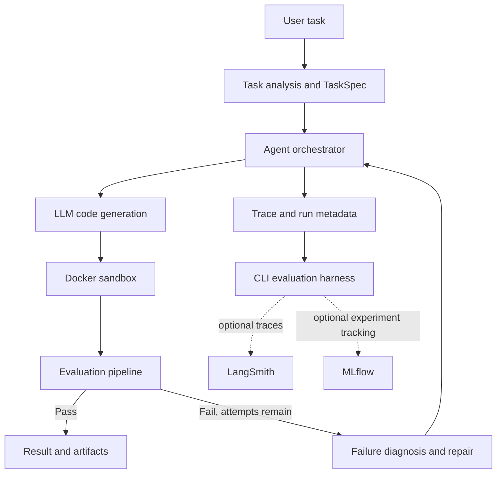

# Sandboxed Coding Agent

A Python-based coding agent that aims to turn natural-language programming tasks into generated code, execute that code inside isolated Docker sandboxes, evaluate the outcome, and perform bounded repair attempts.

> **Project status:** early implementation. The sandbox, initial domain contracts, complexity profiles, and LLM adapters exist in the uploaded baseline. The complete agent workflow and evaluation platform are planned work, not finished features.

## Why this project?

The goal is not simply to wrap an LLM around `exec()`. The project explores the engineering required to make a coding agent measurable and safer:
- clear domain boundaries and provider-independent adapters;
- per-attempt execution isolation and resource controls;
- explicit task specifications and bounded agent state transitions;
- layered evaluation and evidence-based iteration;
- reproducible benchmarks, tracing, and experiment tracking.

## Current implementation snapshot

Implemented in the baseline repository:
- Ports and Adapters contracts for LLM and sandbox.
- Pydantic domain models and complexity profiles.
- Fake LLM and Gemini adapter.
- Docker sandbox adapter and tests for execution, timeout, resource limits, network behavior, artifacts, output capture, OOM reporting, and cleanup.

Not yet wired in that snapshot:
- task analysis/classification;
- code generation and agent orchestration loop;
- evaluator pipeline and repair policy;
- production CLI workflow;
- evaluation datasets/runners/reporting;
- LangSmith and MLflow integrations.

See [Project Overview](docs/PROJECT_OVERVIEW.md) and [Roadmap](docs/ROADMAP_AND_TASKS.md). Re-audit implementation status before every milestone.

## Architecture at a glance



The diagram represents the target architecture, not a claim that all boxes are implemented.

## Development setup

Requirements:
- Python 3.12+
- `uv`
- Docker Engine/Desktop for sandbox integration tests
- Gemini API key only for live provider tests or runs

```bash
uv sync --all-groups
cp .env.example .env
# Add CODEAGENT_LLM_API_KEY to .env only on your machine.
uv run pytest -q
uv run ruff check .
uv run mypy
```

Build the sandbox image from the repository root:

```bash
docker build -t codeagent-sandbox:latest ./sandbox-image
```

The exact working CLI command will be documented once the CLI is implemented. Do not assume the placeholder entry point is functional.

## Documentation map

- [Project overview](docs/PROJECT_OVERVIEW.md)
- [Architecture](docs/ARCHITECTURE.md)
- [Specification and contracts](docs/SPECIFICATION.md)
- [Agentic system design](docs/AGENTIC_SYSTEM_DESIGN.md)
- [Security and threat model](docs/SECURITY.md)
- [Evaluation strategy](docs/EVALUATION.md)
- [Operations and observability](docs/OPERATIONS.md)
- [Roadmap and acceptance criteria](docs/ROADMAP_AND_TASKS.md)
- [Prompt management](docs/PROMPTS.md)
- [Architecture decisions](docs/adr/README.md)

## Project principles

1. Security boundaries must be explicit and tested.
2. The agent must have bounded retries and resource consumption.
3. Deterministic evaluation comes before subjective judge scores.
4. Benchmarks must be reproducible and versioned.
5. Every claimed improvement must have experimental evidence.
