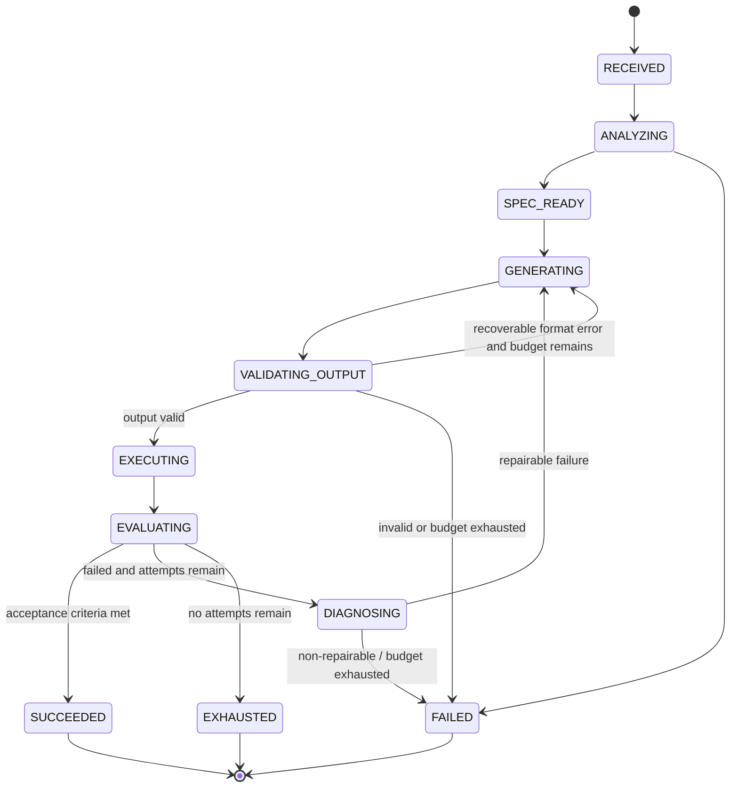

# Agentic System Design

## 1. Objective

The agent is a bounded workflow with explicit transitions—not an unconstrained autonomous loop. It should be possible to reconstruct why each action occurred from its run record.

## 2. Proposed state machine

The exact states may change, but every transition must have a defined trigger, validation, and failure path.

## 3. Attempt lifecycle

1. Build a prompt from the task specification, current code (if any), and bounded diagnostics.
2. Call the LLM through the provider-neutral port.
3. Validate response format and extract code.
4. Apply policy checks before execution.
5. Execute in a fresh sandbox using the least-privilege configuration.
6. Run deterministic evaluators first.
7. Run optional judge evaluators only when useful and within budget.
8. If failure is repairable and budget remains, classify the failure and construct a concise repair context.
9. Stop on success, non-repairable failure, cancellation, or exhausted budgets.

## 4. Failure taxonomy

At minimum distinguish:
- `MODEL_TIMEOUT`
- `MODEL_RATE_LIMIT`
- `MODEL_AUTH_ERROR`
- `INVALID_MODEL_OUTPUT`
- `TASK_SPEC_INVALID`
- `SANDBOX_STARTUP_ERROR`
- `CODE_SYNTAX_ERROR`
- `CODE_RUNTIME_ERROR`
- `CODE_TIMEOUT`
- `RESOURCE_LIMIT_EXCEEDED`
- `NETWORK_POLICY_BLOCKED`
- `DEPENDENCY_INSTALL_ERROR`
- `EVALUATION_FAILED`
- `EVALUATION_INDETERMINATE`
- `ATTEMPTS_EXHAUSTED`
- `CANCELLED`

Do not ask the model to repair infrastructure failures as if they were code bugs.

## 5. Retry and repair policy

- Retry only classified transient failures or code failures with actionable evidence.
- Do not retry authentication errors, policy violations, or repeated identical failures indefinitely.
- Cap attempts, total wall-clock time, token budget, and total sandbox resource consumption.
- Detect repeated code/output hashes or repeated failure signatures to avoid no-progress loops.
- Change one meaningful thing in the repair prompt; preserve previous failure evidence without dumping unlimited logs.
- Record whether a retry actually improved the evaluator outcome.

## 6. Human oversight

For the initial CLI version, explicit user input is sufficient. Future approval gates may be needed before:
- enabling network access;
- installing arbitrary packages;
- writing outside a run workspace;
- using costly models or high resource profiles;
- exporting code or traces to external services.

## 7. Context management

Only pass relevant, bounded context:
- task specification;
- current generated code;
- concise diagnostics;
- previous evaluator results;
- relevant prior attempt summary.

Truncate logs with explicit markers. Never include secrets or unrelated host environment data. Treat task text and workspace files as untrusted content; they may contain prompt injection attempts.

## LLM call policy

Use the LLM only for tasks that need language understanding or generation (for example, task interpretation, code generation, and repair reasoning). Keep deterministic policy decisions, validation, resource-limit enforcement, state transitions, and result checks in ordinary code wherever possible. This reduces cost, improves reproducibility, and limits the model's authority.

During development, actual LLM calls go through the Ollama adapter. The orchestrator sees only the LLM port. Tests substitute `FakeLLM`; no agent state transition should depend on Ollama-specific behavior. Bound retries and repair attempts, and preserve the inputs, outputs, and evaluation result for each attempt.

