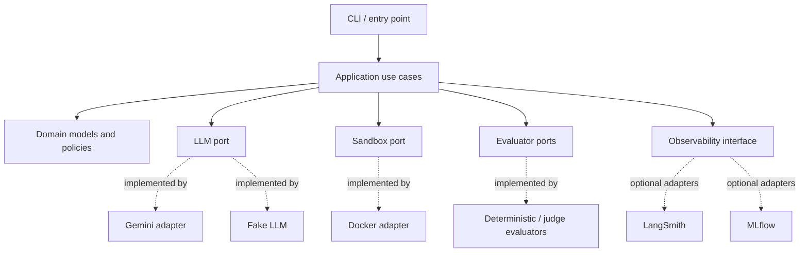
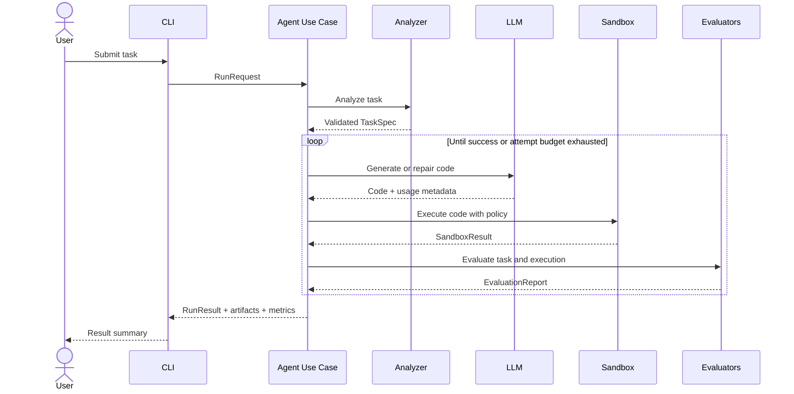

# Architecture

## 1. Status and architecture boundary

This document describes the intended architecture and distinguishes it from the uploaded implementation snapshot. The current source is an early foundation: domain models, LLM and sandbox ports, Gemini/FakeLLM adapters, complexity profiles, and Docker sandbox. The end-to-end application is not yet wired.

## 2. Architectural style: Ports and Adapters

The core application should depend on project-defined interfaces (ports), not vendor SDKs.



**Why:** the agent's decision logic can be tested without live API calls or Docker, and providers can be replaced without rewriting the domain.

**Alternatives:** direct SDK calls are simpler initially but couple business logic to vendors; a plugin framework is more flexible but premature for a small project.

**Trade-off:** ports add interfaces and indirection. Create them at meaningful external boundaries, not for every helper function.

## 3. Target components

| Component | Responsibility | Owns |
|---|---|---|
| Domain | Stable types and invariants | TaskSpec, attempt/result models, limits |
| Application | Coordinates use cases | run lifecycle, retry decisions, orchestration |
| Task analyzer | Converts request to validated task plan | complexity and acceptance criteria |
| LLM adapter | Sends prompts and normalizes responses | provider SDK, usage metadata |
| Sandbox adapter | Runs generated code in isolation | Docker lifecycle and resource enforcement |
| Evaluation | Scores execution against task contract | deterministic evaluators, judge adapter |
| Repair policy | Decides whether/how to retry | error categories, attempt budget |
| CLI/bootstrap | Parses input and wires adapters | configuration and dependency construction |
| Observability | Emits structured run/attempt events | trace IDs, spans, metrics |
| Evaluation harness | Runs benchmark datasets and compares runs | datasets, evaluators, reports |

## 4. Target run sequence



## 5. Key design decisions

### 5.1 Fresh container per attempt
Already recorded in ADR 0002. This reduces state leakage between attempts and gives each attempt a fresh resource boundary. It costs container startup time and is not a complete VM-grade security boundary.

### 5.2 Separate generation, execution, and evaluation
Do not let an LLM declare its own output successful. The sandbox reports what happened; deterministic evaluators verify expected behavior; a judge can assess qualities that lack an objective oracle.

### 5.3 Bounded state machine, not an unconstrained loop
The application should have explicit states and transitions, maximum attempts, time budget, and terminal outcomes. This makes behavior testable and prevents runaway cost or execution.

### 5.4 CLI-first, observability integrations optional
The CLI and local evaluation harness are the reproducible foundation. LangSmith can provide traces and agent trajectory inspection; MLflow can track experiments and artifacts. Core logic must not require either service.

### 5.5 Avoid premature distributed infrastructure
The existing roadmap mentions API, Redis, Postgres and workers. These are not prerequisites for a reliable local coding agent. Add them only after a concrete concurrency, persistence, or deployment requirement exists and after single-run behavior is measured.

## 6. Dependency direction

```text
domain <- application <- adapters / infrastructure <- bootstrap
```

Domain must not import Docker, Gemini SDKs, LangSmith, MLflow, Typer, or persistence implementations. Application depends on domain contracts. Bootstrap wires concrete adapters.

## 7. Failure boundaries

- LLM timeout/rate limit/invalid response: bounded retry policy; no sandbox execution until output is validated.
- Sandbox startup failure: classify as infrastructure failure, not code failure.
- Code runtime failure: pass bounded diagnostics to repair stage.
- Evaluator failure: mark evaluation as errored/indeterminate, never silently pass.
- Observability outage: local run should continue unless tracing is explicitly configured as mandatory.
- Cancellation: stop active execution and clean up resources.
